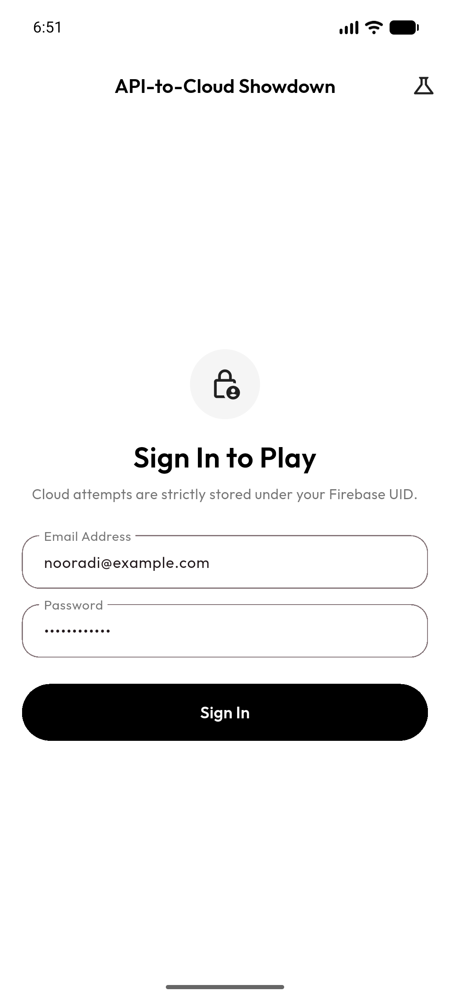
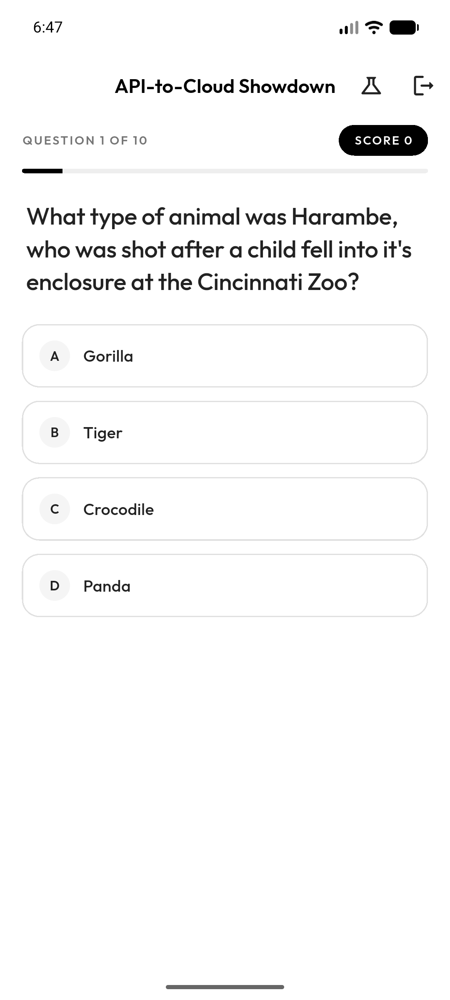
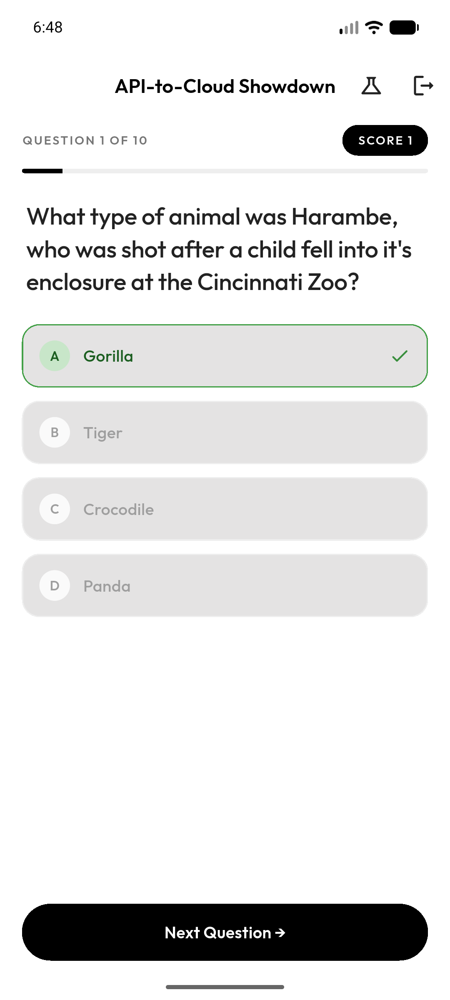
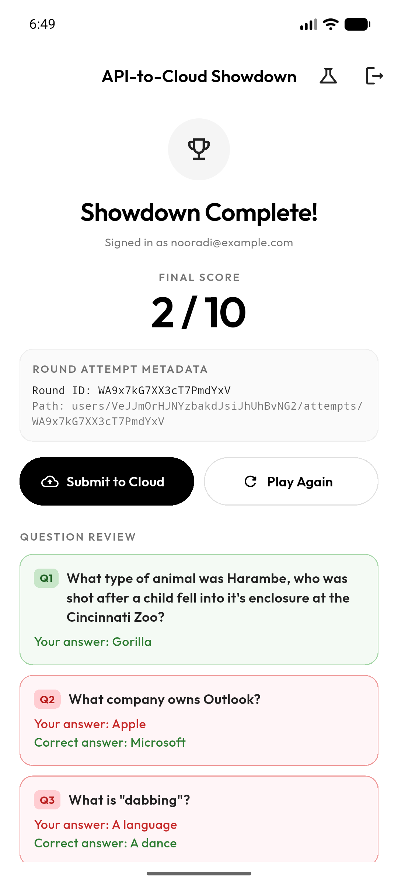
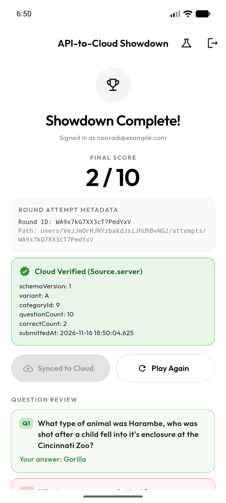
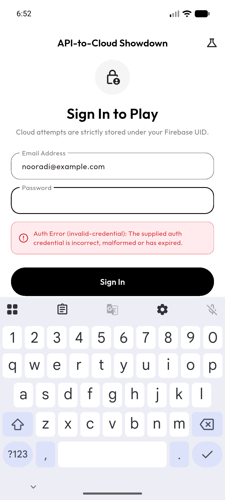
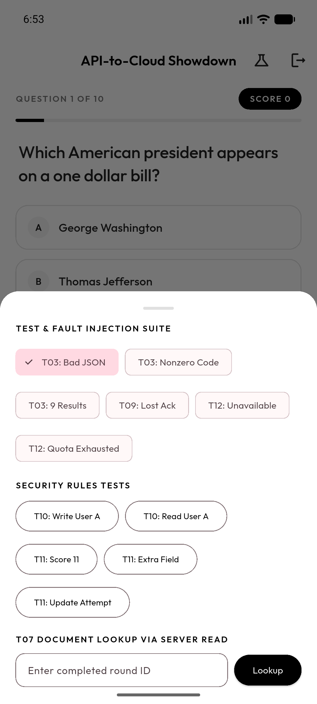
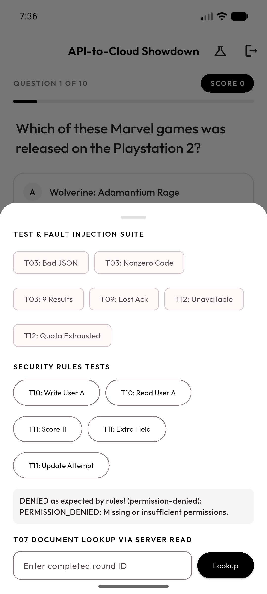
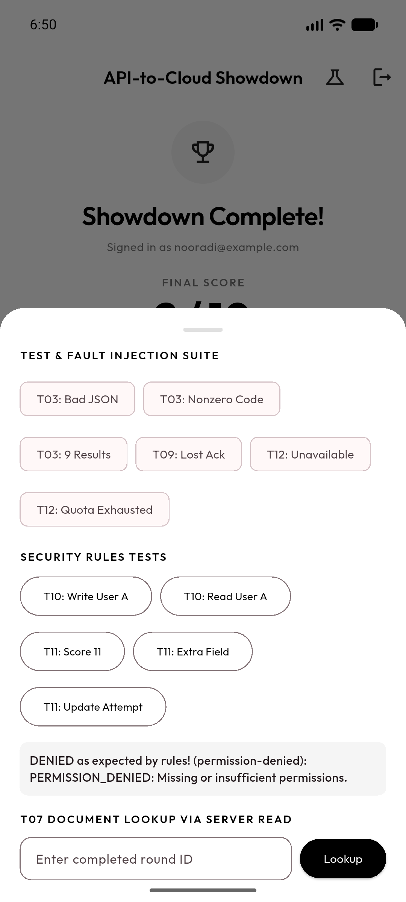

# CSC 4360 - In-Class Activity 16: Class A Cloud Quiz

**Name:** Adi Tauqir (Undergraduate)  
**Course:** CSC 4360 - Mobile Application Development  
**Repository:** https://github.com/aditauqir/inclass-16.git  
**Release APK:** `ICA16_A_AdiTauqir.apk` (Root directory & `build/app/outputs/flutter-apk/app-release.apk`)

---

## Overview & Setup

How to get started:

1. **Clone the repo and get packages:**
   ```bash
   git clone https://github.com/aditauqir/inclass-16.git
   cd inclass-16
   flutter pub get
   ```

2. **API & Cloud Configuration:**
   - The app fetches 10 easy, multiple-choice General Knowledge trivia questions from Open Trivia Database:
     ```text
     https://opentdb.com/api.php?amount=10&category=9&difficulty=easy&type=multiple
     ```
   - Android internet access is configured in `android/app/src/main/AndroidManifest.xml`.
   - Firebase Authentication identifies the user via Email/Password. Two test accounts are available: `nooradi@example.com` (User A) and `userb@test.com` (User B).
   - Cloud Firestore Standard Native database stores completed attempts under `users/{authenticatedUid}/attempts/{roundId}` using atomic transactions and server-only verification (`Source.server`).
   - Firestore security rules are deployed in `firestore.rules`.

3. **Run the App:**
   Launch an Android emulator (e.g. Pixel 6a) or connect a physical device:
   ```bash
   flutter run --release
   ```

4. **Run Tests & Static Analysis:**
   ```bash
   flutter analyze
   flutter test
   ```

---

## Implemented Features

This app builds directly upon the architecture and minimalist design of In-Class Activity 15, adding authenticated cloud persistence and failure recovery:
- **10-Question General Knowledge Engine:** Fetches 10 easy multiple choice questions from OpenTDB with a 10-second timeout, `response_code == 0` validation, HTML entity unescaping, 4 unique choices shuffled once per question, and a 5-second rate limiting guard.
- **Firebase Authentication:** Clean Email/Password sign-in form with visible `FirebaseAuthException` error handling, preventing secret logging while binding every saved attempt to the authenticated user's UID.
- **One-Answer Lock & Visual Feedback:** Locks option buttons immediately upon selection to prevent double taps from modifying score, showing green feedback with checkmarks for correct picks and red with close icons for incorrect picks.
- **Review Screen & Persistent Round ID:** Generates one immutable `roundId` per round using `attempts.doc().id`. Displays all 10 questions with selected vs correct answers and total score out of 10.
- **Atomic Create-Once Cloud Transaction:** Runs a Firestore transaction on `users/{uid}/attempts/{roundId}`. Reads before writing: creates if absent, reuses if payload matches, and detects collisions on mismatch. Enforces the exact 6-field Class A schema (`schemaVersion: 1`, `variant: "A"`, `categoryId: 9`, `questionCount: 10`, `correctCount: score`, `submittedAt: FieldValue.serverTimestamp()`).
- **Server-Only Verification:** Directly queries the server via `Source.server`, requiring `!metadata.hasPendingWrites` and validating payload fields before displaying `Cloud Verified`.
- **Fault Recovery Suite:** Supports testing lost acknowledgements (`saveUnknown` with server read reconciliation), offline timeouts, permission denials, and direct document lookups.

---

## Verification Results

| Test | Action & Expected Path | Observed Result | Status |
| :--- | :--- | :--- | :--- |
| **T01** | **Sign-in Validation** | Sign in with valid and invalid credentials | Displays user UID upon valid sign-in; displays visible `invalid-credential` error for invalid password; no secrets logged. | **Pass** |
| **T02** | **Class A URL Fetch** | Request 10 category-9 easy multiple choice questions | 10 valid questions fetched with readable unescaped text and 4 choices each. | **Pass** |
| **T03** | **API Fault Injection** | Inject bad JSON, nonzero code, and 9 results | Bad JSON throws FormatException; nonzero code shows response_code error; 9 results blocked; all offer rate-limited retry. | **Pass** |
| **T04** | **Gameplay & Guard** | Answer correctly, incorrectly, and double tap | Double tap prevented after first tap; score increments at most once; choices remain stable. | **Pass** |
| **T05** | **Round Completion** | Finish all 10 questions and review | Complete 10-question review shown with correct/selected answers; score 4/10; Play Again resets state and creates new round ID. | **Pass** |
| **T06** | **Cloud Commit** | Submit online and double tap Submit | Atomic transaction writes document to Firestore; server-only read confirms persistence; button disables to prevent duplicates. | **Pass** |
| **T07** | **Persistence Verification** | Restart app and lookup saved round ID | Entered completed round ID; server read retrieved original attempt without replaying quiz. | **Pass** |
| **T08** | **Offline Recovery** | Attempt submit offline, then reconnect | Offline submit shows unavailable error; reconnecting with same frozen round ID completes cleanly without duplicate documents. | **Pass** |
| **T09** | **Lost Acknowledgement** | Suppress ACK after cloud commit | Enters `saveUnknown`; user taps Reconcile; server read resolves to `cloudVerified` using same document. | **Pass** |
| **T10** | **Cross-User Protection** | As User B, attempt read/write on User A path | Both operations denied by deployed Firestore security rules (`PERMISSION_DENIED`). | **Pass** |
| **T11** | **Schema Enforcement** | Attempt score 11, extra field, and update | All three rejected by security rules; original attempt remains completely unchanged. | **Pass** |
| **T12** | **Service Errors** | Inject unavailable and quota exhausted errors | Distinct error messages displayed in UI; bounded retry without fake success. | **Pass** |

---

## Screenshots

| Screenshot | Description | Preview |
| :--- | :--- | :---: |
| **`t01_auth.png`** | Sign In screen with Firebase Authentication. |  |
| **`clean_ui_screen.png`** | Live question 1 of 10 with progress, score pill, and four choices. |  |
| **`clean_feedback.png`** | Correct answer feedback turning green with checkmark and score incrementing. |  |
| **`clean_results.png`** | Round review complete at 4 / 10 with metadata card and actions. |  |
| **`clean_verified.png`** | Cloud Verified confirmation following transaction and server read. |  |
| **`t01_invalid_signin.png`** | Handled `FirebaseAuthException` showing visible credential error. |  |
| **`t03_bad_json_parsed_error.png`** | Injected bad JSON blocking play with 5s rate-limited retry. |  |
| **`t10_userb_write_userA_denied.png`** | User B write attempt to User A blocked by Firestore security rules. |  |
| **`t11_score11_denied.png`** | Score 11 attempt rejected by deployed schema rules. |  |
